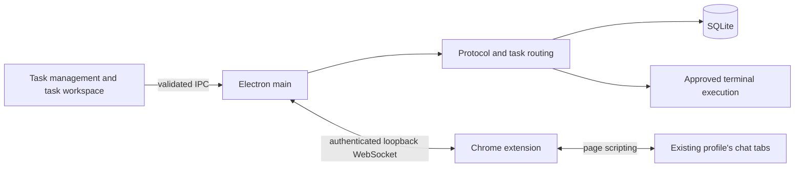

# Architecture

Relay's Electron main process owns task state, SQLite persistence, protocol validation, and execution authorization. Chrome owns the user's signed-in sessions. The extension binds the two chat URLs of a task to tabs in the profile where it was installed.

## Source map

- `apps/desktop/renderer/main.tsx`: renderer entry point; `App.tsx` composes the views.
- `apps/desktop/renderer/features`: task management, task workspace, message rendering, and settings, each in its own folder. Workspace components separate chat URL connection, message composition, history search, and the handover tool.
- `apps/desktop/renderer/components`: shared Chrome connection UI and application layout.
- `apps/desktop/renderer/hooks`: application snapshots, action errors, and persisted panel preferences.
- `apps/desktop/renderer/styles`: ordered stylesheets for base elements, layout, and individual features, imported through `index.css`.
- `apps/desktop/electron/main.ts`: application lifecycle, service initialization, snapshots, and extension installation folder.
- `apps/desktop/electron/ipc.ts`: trusted-frame checks, input validation, clipboard access, and action dispatch. `preload.ts` exposes the shared IPC contract.
- `packages/orchestration/handover.ts`: three Watcher-authored handover requests addressed to the Operator. Message.handoverRole retains a role-specific request through delivery, reply capture and retry. The project variant adds evidence only; replacement variants add the exact active protocol, explicit role identity/duties/next work, counter explanation and checkpoint. HandoverTransfer.tsx previews and copies the fixed-mode artifact; it has no role selector. Automatic onboarding services and IPC actions are removed.

`needsAgentInstructions` checks confirmed full-protocol delivery to the specific assignment and conversation or a verified `Agent.manualHandover` receipt for the same current protocol and delivery rules. It never trusts a saved onboarding label or bare response counter. The extension returns the stable visible acknowledgment at connection; `acceptManualHandover` matches its role, unchanged checkpoint, task, generated report and versioned receipt before recording protocol delivery. The manual setup acknowledgment consumes no project response number. The next actual project response increments by one. Missing or outdated protocol evidence triggers full instruction delivery; explicit retries preserve this distinction. Source IDs and complete source text must agree for every handoff.

The page inspector merges supported assistant selectors in document order and deduplicates nested turn wrappers. `matchesExpectedResponse` binds captures to the assigned role and expected counter; the desktop separately checks the saved chat URL before accepting and acknowledging them. Old or cached unmatched captures do not clear a pending delivery. Persisted unnumbered captures tied to a confirmed extension delivery may be marked `Message.captureRejected` and resumed through read-only inspection of that delivery. Their content remains recorded, but ignored captures cannot be handed off, answer Operator requests, authorize commands, or enter replacement evidence. Recovery never resends the original prompt.

- `apps/desktop/electron/chrome/ChatConnections.ts`: task connection selection, transport integration, pending deliveries, reconnection, and delayed-response task association.
- `apps/desktop/electron/chrome/extension-bridge.ts`: loopback connection, extension origin validation, pairing, and correlated requests.
- `apps/desktop/electron/InstructionFiles.ts`: instruction file validation, backup, activation, and disk change watching.
- `apps/desktop/electron/window.ts`: window creation and renderer security settings.
- `apps/chrome-extension`: Chrome service worker and connection popup.
- `packages/chrome-connection`: shared connection messages, four adapter configurations, and the injected page operations.
- `packages/orchestration/core.ts`: task assignments, counters, handoffs, handover requests, and message state. `initial-state.ts`, `batch-review.ts`, and `handover.ts` isolate initial configuration, exact command review, and manual handover construction.
- `packages/orchestration/migrate.ts`: legacy global-agent history migration.
- `packages/orchestration/store.ts`: SQLite snapshots and event records.
- `packages/orchestration/terminal.ts`: approved Bash and PowerShell execution through the configured executable, shell validation, chat-confirmed working directories, output capture, and process-tree cancellation. `execution-policy.ts` requires explicit approval for both roles and applies shared command safeguards; automatic execution is unavailable. There is no Watcher-specific command allowlist.
- `packages/protocol/parser.ts` and `packages/agent-instructions`: message parsing and full `agent.md` preservation. `packages/protocol/fences.ts` preserves original code whitespace and line endings for full and collapsed views. Saved summary notices are refreshed during recovery without replaying historical batches or changing their review status.
- `packages/shared/types.ts`: persisted data models; `actions.ts`: runtime action validation; `ipc.ts`: the renderer/preload contract. Shared helpers centralize conversation URLs, running execution detection, and unresolved-delivery checks used by both the core and composer.
- `packages/shared/context-health.ts`: the receiving role's context-check footer, idempotent attachment, and lookup of the original role response 1 for replacement packets. `components/ContextAlerts.tsx` displays persistent recommendations across task views.
- `tests`: grouped by orchestration, renderer, Chrome connection, and desktop services.
- `scripts/smoke`: provider fixtures, workspace acceptance checks, and CDP transport used by `scripts/smoke.mjs`.

## Maintenance checks

`npm run check` enforces formatting, TypeScript types and unused-code checks, the test suite, and production builds. `npm run format` applies the shared formatting rules. Generated outputs and the exact `agent.md` protocol text are excluded from formatting. Existing database migrations and historical instruction versions are retained for compatibility.

## Connection and delivery

Relay listens on `127.0.0.1:19432`. A persistent, cryptographically generated token contains exactly 64 hexadecimal characters. Only the extension's stable origin is accepted. The token is stored separately from exported history. One Chrome profile connects at a time.

The extension searches its own profile for an exact saved URL, preferring an active matching tab. It creates a tab only if no match exists. No cookies, passwords, provider APIs, or browser-profile files are read by Relay. Page scripting runs only on the four supported services and only in bound tabs. It can attach to a chat already open before the extension was installed.

Cached tab ownership is scoped to a hash of the pairing token and bridge port. The desktop supplies all active assignment IDs during connection so obsolete cache entries cannot reserve tabs. A browser tab navigated to a different chat can be rebound while the previous assignment and pending evidence remain disconnected; reconnecting its original URL preserves that evidence. Per-attempt cancellation prevents a late connection from reviving a removed assignment. Same-identity reconnection preserves pending deliveries, and older unscoped caches are rebuilt from the desktop without automatic submission.

Before sending, the adapter checks the saved URL, identifies a unique visible composer, rejects an existing draft, and checks generation state. It fills text through native textarea input or a rich-text editing operation, dispatches input events, verifies the entire message, and activates a unique enabled Send control once. Failure before activation is distinguished from uncertain submission. An uncertain send is never replayed automatically.

The extension saves the pre-send assistant turn baseline and delivery identity in Chrome session storage. It captures a new assistant turn only after generation controls disappear and text stabilizes. Thinking sections and page controls are excluded; code fences and command whitespace are retained. Responses include the original task and delivery IDs, so switching tasks cannot reroute a reply. Deleting the originating task drops its late replies and removes its extension bindings.

DOM code capture selects a backtick fence longer than every run inside the code body. This preserves Markdown references with nested examples without treating those examples as live batches. An explicit `refreshCapturedCode` action can reread the latest unrecorded Actor proposal and pending Watcher approval after an extension update. It requires their confirmed delivery chain, current roles, counters and URLs, and byte-identical legacy serialization after collapsing only the outer delimiters. Both parses must agree on the exact command, shell and directory. The original captures are retained in `Message.originalCapture`, and the repair commits atomically only after exact review succeeds. It sends no prompt, advances no counter and runs no command; startup does not perform this repair.

## Task and execution boundaries

Each task has one active Actor and Watcher. Editing a role URL explicitly retires its previous connection and registers the replacement without sending any packet or prompt. The response checkpoint and briefing state carry forward, context warnings start fresh, and unexecuted batches involving the retired member are withdrawn. Running execution blocks replacement before mutation. The extension returns both visible response number and role; only a matching role may advance a manually prepared chat checkpoint. Chats cannot be shared across tasks or roles. Task deletion cascades through assignments, messages, batches and runs while retaining log files.

`packages/shared/task-start.ts` requires a confirmed outgoing Watcher delivery within the task before Actor sends. The composer disables Send to Actor, its keyboard handling defaults to Watcher, and the core rejects premature Actor sends before appending or submitting them. Failed, pending, and uncertain deliveries do not unlock the Actor. Recorded instruction-recipient roles retain startup evidence across Watcher replacement; other tasks cannot supply that evidence.

`packages/shared/operator-replies.ts` derives ordinary Operator requests in arrival order. Confirmed answers target the sender using replyToId; failed and uncertain sends do not unlock other actions. Generated handover documents are exempt because the Operator consumes them by manual copying and URL replacement. Retired automatic-transfer requests and ignored captures do not create reply locks. Ordinary questions keep the same mandatory reply rule.

Every outbound Relay message ends with one context-check footer, including retries. Only matching-role, expected-counter replies update persisted context health. Losing an established response-1 reference latches an advisory suggestion to onboard a new member of that role. New assignments do not inherit retired warnings. The manual packet includes the original role response 1 once when recorded and preserves continued counters. Missing or conflicting metadata is not proof of context exhaustion; this remains an agent-reported signal.

Generated handover requests carry purpose=handover. They and their generated reports are omitted from subsequent raw evidence snapshots to prevent recursive growth. The report is included once, verbatim, in the copied manual packet. Generated documents cannot authorize commands or create Operator answer fields. Retired Task.onboarding state is migrated without replay; a confirmed staged delivery is retained, while an unconfirmed staged assignment is discarded. Historical bodies and actual execution records remain intact.

`Parsed.handover` identifies HANDOVER PACKET or a correlated handover request. Directories, question IDs and approvals within that document are historical content. The final Summary and context status remain current metadata. Parsed.onboardingRole only supports historical packet display. Recovery refreshes obsolete document notices without changing bodies or granting command execution permission.

The workspace offers explicit Actor and Watcher delivery buttons and a toolbar with handover, handover for new actor, handover for new watcher, and editable role URL fields. Complete message bodies start collapsed. Bash and PowerShell code appear alongside the agent-authored summary. The code toolbar provides Copy code, Execute command, and Copy result, including in expanded text. The optional persisted `Batch.shell` and `Parsed.batchShells` retain shell identity; older records default to Bash. Execution validates that the configured terminal executable matches the batch shell. Both roles may request file-changing commands and valid Bash `&&` chains with explicit user approval. The legacy `Batch.inspection` field identifies a Watcher-authored batch for evidence routing; it no longer restricts execution to an allowlist.

`Parsed.workingDirectory` reads an explicit Working directory line outside fences and Operator input. Review preserves it in `Batch.cwd` and rejects changes to the proposed directory. Execution requires an existing absolute directory; there is no global workspace fallback. Settings retain only the executable and timeout; startup migration drops retired workspace, separator, mode, and allowlist configuration without altering evidence. Operator separators are automatic. No notification or startup path executes commands; every batch requires an approved run action.

An exact Actor proposal can become ready in one Watcher response addressed to the Operator with an explicit APPROVED marker and identical code and shell. That response records both `reviewId` and `forwardedId`; an older separate review remains compatible. An approval-only reply to the Actor offers a request to the Watcher for execution instructions instead of another Actor handoff. Eligible Operator batches receive a fallback output-answer field if the original response omits numbered questions. Delivery rules have an independent persisted message version so existing chats receive updates without rewriting custom instruction files or resetting counters.

For duplicate unreviewed proposals with identical code and shell, a directory correction is resolved only when one matching revision is newer than the other proposals from that same Actor and was delivered to this Watcher before the explicit approval. Older revisions become rejected only when the correction becomes ready. A saved conflict is re-evaluated through the explicit `recheckReview` action for the current pending Watcher request; it cannot authorize later proposals, start a run, send a message or reset counters. Startup continues to refresh display metadata without granting historical execution permission.

Previously untracked PowerShell proposals can be restored on a new explicit Watcher approval only when the original exact Actor proposal, preceding delivered Watcher briefing, and confirmed proposal delivery to that Watcher are recorded in the same task. Ambiguous or already-recorded proposals are not restored. Startup itself refreshes command visibility without authorizing or executing historical code.

The renderer has context isolation, sandboxing, and Node disabled. IPC accepts only the main renderer frame and validates actions with Zod. The extension has tab, storage, alarm, and scripting permissions, with host access limited to the supported chat websites. Actor-proposed commands require exact Watcher review; the Watcher may request her own batch directly. Every execution requires Operator approval and runs with the user's permissions.

Execution controls and captured output live beside the approved conversation message. `executionResult` formats captured evidence consistently for the clipboard, direct handoff, and first output answer. The answer is filled once per finished run, preserving other answers and subsequent edits; it is not submitted automatically. Internal batches, runs, and bounded stdout/stderr previews remain for authorization, duplicate-execution prevention, and handover evidence; there is no separate execution-history or log-viewer feature.
